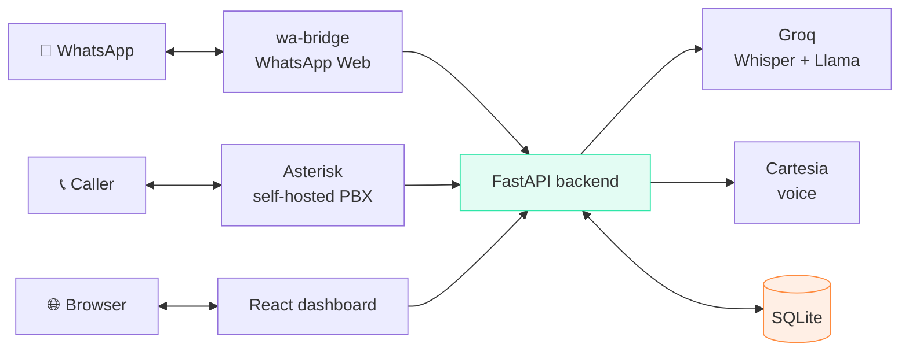

# VoiceFlow AI

**Your voice. Your accent. Answering every customer.**

A self-hosted AI agent for Indian small businesses. It answers calls and
WhatsApp messages 24/7, in whatever language the customer speaks, and logs
every conversation into one dashboard.

**Team — Voice Flow** · Abhinav Cheepa (Lead) · Raghav Goyal

---

## What actually works today

Nothing below is a mock. Every row was measured on a real run.

| Feature | State | Notes |
| ------- | ----- | ----- |
| **Web call** — talk to the agent in the browser | ✅ working | ~4s per turn, end to end |
| **WhatsApp auto-reply** — text and voice notes | ✅ working | via WhatsApp Web, no Meta KYC |
| **Multiple agents** — different personas | ✅ working | picked per call |
| **Voice** — 55 ready voices, 6 Hindi | ✅ working | Cartesia |
| **Contacts / CRM** — auto-built from calls + chats | ✅ working | one timeline per customer |
| **Campaigns** — bulk outbound list | ✅ built | needs telephony to dial |
| **Analytics** — volume, outcomes, per-agent | ✅ working | |
| **Phone calls** — real PSTN | ⚠️ partial | Asterisk answers and logs; live audio is not wired yet |
| **Voice cloning** — the owner's own voice | ⚠️ blocked | Cartesia charges for cloning; ready voices used instead |

The honest summary: **web call and WhatsApp are demoable right now.** Phone
calls need hardware that isn't set up yet — see [Telephony](#telephony).

---

## Quick start

Requirements: **Node 18+**, **Python 3.10+**.

```bash
git clone <repo-url> && cd voiceflow-ai
```

```bash
python -m venv backend/venv && backend/venv/Scripts/pip install -r backend/requirements.txt
```

```bash
npm install
```

Copy `backend/.env.example` to `backend/.env` and add the two keys under
[API keys](#api-keys). Then, on Windows:

```powershell
.\start.ps1
```

That starts the backend, the dashboard and the WhatsApp bridge, and prints what
is live. Stop everything with `.\start.ps1 -Stop`.

Open **http://localhost:5174/app**.

<details>
<summary>Starting the pieces by hand (macOS / Linux)</summary>

```bash
cd backend && ./venv/bin/uvicorn main:app --port 8000
```

```bash
npm run dev
```

```bash
cd wa-bridge && npm install && BRIDGE_TOKEN=<from .env> npm start
```

</details>

---

## API keys

Two keys get everything working. Both have a free tier that needs no card.

| Key | Where | Used for | Required? |
| --- | ----- | -------- | --------- |
| `GROQ_API_KEY` | [console.groq.com](https://console.groq.com) | Speech-to-text + replies | **Yes** |
| `CARTESIA_API_KEY` | [play.cartesia.ai](https://play.cartesia.ai) | The agent's voice | **Yes** |
| `WHATSAPP_PROVIDER=web` | — | WhatsApp without KYC | for WhatsApp |
| `VAPI_PRIVATE_KEY` | [vapi.ai](https://vapi.ai) | Phone calls, hosted route | optional |
| `ASTERISK_ARI_PASSWORD` | your own Asterisk | Phone calls, self-hosted | optional |

Without Groq the app still starts and falls back to a local Whisper model — no
key, no bill, but roughly 6s per transcription instead of 1.3s.

`backend/.env.example` documents every variable with where to get it.

> A key left **blank** in `.env` is treated as "use the default" — the app
> strips empty values at startup so they can't silently override a default with
> an empty string.

---

## How it fits together



One pipeline serves all three channels:

**audio in → transcribe → agent replies → speak → send back**

Full detail, module by module: **[docs/ARCHITECTURE.md](docs/ARCHITECTURE.md)**

---

## Using the dashboard

### Agents
Each agent is a persona: a name, a greeting, a language, and instructions. Put
your real business facts in the instructions — timings, prices, services — and
**also say what the agent does not know**. It then defers instead of inventing.

The agent is told it has no calendar, so it will never claim a slot is free. It
takes the name and time and says it will confirm.

### Web call
Pick an agent, press call, talk. Same pipeline a phone caller gets. The browser
decides when you've stopped speaking and sends that turn.

Half-duplex — the agent finishes before it listens again. Interrupting
mid-sentence needs the streaming media loop that isn't built yet.

### WhatsApp
Scan the QR once. After that, messages arrive in the dashboard and the agent
replies on its own — text gets text, a voice note gets a voice note.

Two switches control it:

- **Auto-reply** — the master switch. Off, and messages still arrive and are
  stored; they just don't get answered.
- **Only reply to these numbers** — an allowlist. **Essential if the number
  also carries personal chats**, or the agent will answer your friends.

Each conversation also has its own toggle, for taking one chat over by hand.

### Voice Studio
Pick the voice for every call and voice note. 55 voices, filtered to Hindi,
Tamil, Telugu and English. Preview auditions a voice without switching to it.

Also where you describe the **writing style** for WhatsApp text replies.

### Contacts, Campaigns, Analytics
Contacts build themselves from calls and messages, with both channels merged
into one timeline. Campaigns take a pasted list of numbers and dial them one at
a time. Analytics covers volume, outcomes and per-agent breakdown.

---

## Telephony

Asterisk is free. Reaching the phone network is not. The options, honestly:

| Route | Cost | State |
| ----- | ---- | ----- |
| **Android + Bluetooth** — your SIM in an old phone | ₹0, incoming is free in India | configs + installer ready, needs a Linux box |
| **SIP trunk** (Exotel, Plivo) | ~₹500–1500/mo + per minute | needs business KYC |
| **USB GSM dongle** | ₹8k–25k hardware | `chan_dongle` is largely unmaintained |
| **Vapi** | per minute, USD | fastest to demo, US numbers |

**Asterisk needs Linux.** Not Windows, not macOS — `chan_mobile` depends on
BlueZ, which is Linux-only. WSL2 has no Bluetooth passthrough either.

Guides: [GSM-GATEWAY.md](docs/GSM-GATEWAY.md) (your SIM, step by step) ·
[PHONE-SETUP.md](docs/PHONE-SETUP.md) (getting a number) ·
[ASTERISK.md](docs/ASTERISK.md) (install) ·
[ASTERISK-PLAN.md](docs/ASTERISK-PLAN.md) (what's left, with estimates)

---

## Documentation

Everything lives in **[docs/](docs/README.md)** — architecture, WhatsApp setup,
telephony guides. Component notes sit next to their code
([wa-bridge](wa-bridge/README.md)).

---

## Project layout

```
voiceflow-ai/
├── src/                  React dashboard + landing page
│   ├── pages/            one file per screen
│   ├── api.js            fetch helper + polling hook
│   └── ui.jsx            shared components
│
├── backend/              FastAPI — the brain
│   ├── main.py           every route
│   ├── db.py             SQLite schema and queries
│   ├── brain.py          Groq: transcription + replies
│   ├── voice.py          Cartesia: voices + speech
│   ├── whatsapp.py       WhatsApp logic, provider-agnostic
│   ├── whatsapp_web.py   client for the local bridge
│   ├── webcall.py        browser call session
│   ├── vapi.py           hosted telephony
│   ├── asterisk_ari.py   self-hosted telephony
│   └── test_brain.py     runnable checks
│
├── wa-bridge/            Node service driving WhatsApp Web
├── asterisk/             PBX config + Ubuntu installer
├── docs/                 architecture and setup guides
└── start.ps1             starts everything
```

Each external service is owned by exactly one file, so swapping a provider is
one file's worth of work.

---

## Tests

```bash
cd backend && ./venv/Scripts/python test_brain.py
```

Covers language detection, WhatsApp payload parsing, and the filter that stops
Whisper hallucinations reaching the agent. No framework — plain asserts.

---

## Known limits

Deliberate, with the upgrade path:

- **Phone-call audio isn't wired.** Asterisk answers and logs; the streaming
  media loop is 7–10 days of work ([plan](docs/ASTERISK-PLAN.md)).
- **Voice cloning needs a paid Cartesia plan.** Ready voices are used instead.
- **WhatsApp Web is against WhatsApp's terms.** Numbers can be banned — use a
  dedicated SIM, never a personal one. Chat import is broken by library drift;
  live messages work.
- **No auth on the dashboard API.** Add a token before exposing it publicly.
- **SQLite, single file.** Fine for one business; move to Postgres for
  concurrent writers — only `db.py` changes.
- **Half-duplex conversation.** No barge-in.

---

## Live demo

_Coming soon._ Until then the web call at `/app/web-call` runs the full pipeline
locally.
