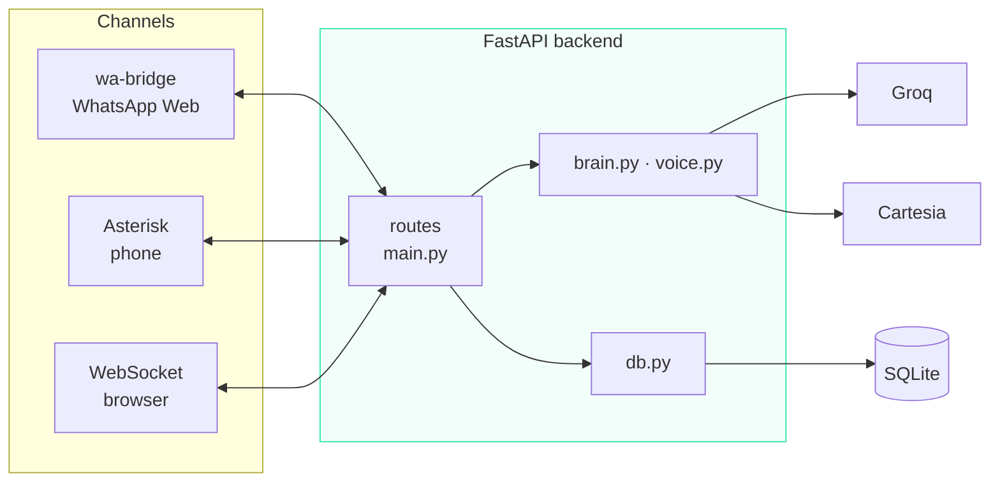
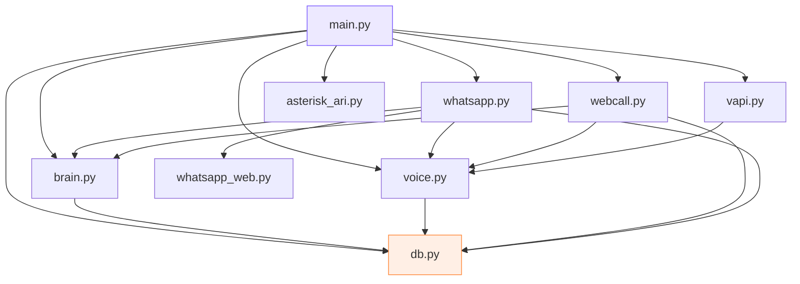
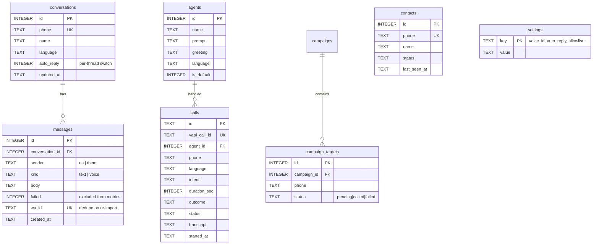
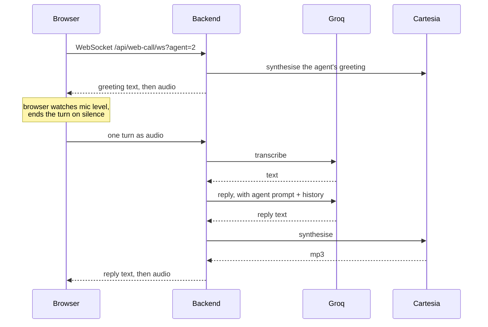
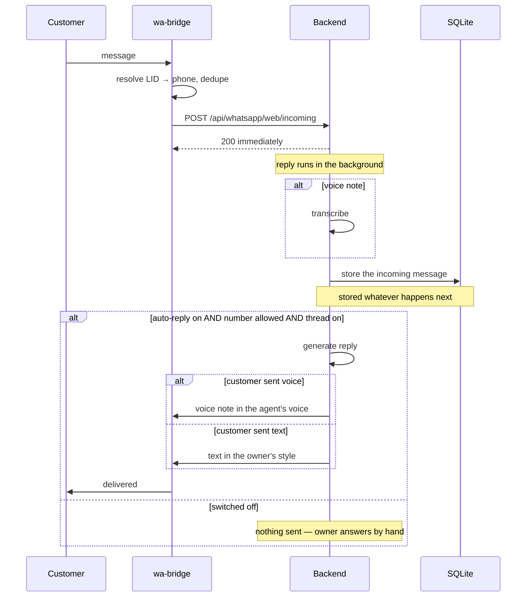
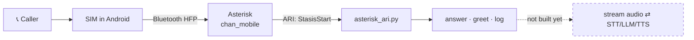

# Architecture

Developer documentation. What each file does, how the pieces connect, and the
handful of decisions that are easy to break if you don't know why they're there.

For setup and usage, see the [README](../README.md).

---

## 1. The shape of it

Three channels — browser, WhatsApp, phone — all funnel into **one** pipeline:

```
audio or text in  →  transcribe  →  agent replies  →  speak  →  send back
```

The backend owns that pipeline and nothing else owns any part of it. Channels
are adapters: they convert their protocol into "here is a message from this
person" and hand it over.



**Adding a channel means adding an adapter, not a second pipeline.** That's why
WhatsApp gained a whole new provider (Meta → WhatsApp Web) without `brain.py`
or `db.py` changing at all.

---

## 2. Files

```
backend/
├── main.py            every HTTP route and the two webhooks
├── db.py              SQLite: schema, queries, migrations
├── brain.py           Groq — transcription, replies, language detection
├── voice.py           Cartesia — voice library, speech, cloning
├── whatsapp.py        WhatsApp logic, provider-agnostic
├── whatsapp_web.py    client for the local wa-bridge
├── webcall.py         one browser call session
├── vapi.py            hosted telephony
├── asterisk_ari.py    self-hosted telephony
└── test_brain.py      runnable checks
```

| File | Owns | Swap it if… |
| ---- | ---- | ----------- |
| `brain.py` | api.groq.com | moving to OpenAI, Together, a local model |
| `voice.py` | api.elevenlabs / cartesia | moving to ElevenLabs, PlayHT, Sarvam |
| `whatsapp_web.py` | the local bridge | moving to Twilio or 360dialog |
| `vapi.py` | api.vapi.ai | moving to Bland, Retell |
| `asterisk_ari.py` | your Asterisk | moving to FreeSWITCH |

Nothing outside those files imports a provider's URL or SDK.

Outside `backend/`:

| Path | What |
| ---- | ---- |
| `src/` | React dashboard and landing page |
| `wa-bridge/` | Node service driving WhatsApp Web — [its own README](../wa-bridge/README.md) |
| `asterisk/` | PBX config and the Ubuntu installer |
| `start.ps1` | starts backend + dashboard + bridge together |

Gitignored and regenerable: `venv/`, `node_modules/`, `dist/`, `voiceflow.db`,
`wa-bridge/.session/`, `bridge*.log`. **`backend/.env` is gitignored and holds
every key** — it does not travel with the repo.

---

## 3. Module dependencies



`db.py` is the leaf — it imports nothing of ours. One direction throughout, no
cycles.

---

## 4. Data model



Three things worth knowing:

**`settings` is key/value on purpose.** The voice id, the writing style and the
allowlist are created at runtime, not at deploy time, so they don't belong in
`.env` or a fixed-column table.

**`messages.failed` keeps metrics honest.** When a reply can't be sent, the
error is written to the thread so the owner sees the gap — but flagged, so it
doesn't count as a reply in the response-rate figure.

**Contacts build themselves.** `db.touch_contact()` runs on every call and
message, so the CRM fills with no data entry. `get_contact()` merges calls and
messages into one timeline, joined on phone.

Migrations are additive and applied at startup (`db.MIGRATIONS`) —
`CREATE TABLE IF NOT EXISTS` will not add a column to a table that already
exists, which is what that list is for.

---

## 5. Flow — browser call



Measured: **~4s per turn** (transcribe 1.3s, reply 1.0s, speech 1.8s).

Turn detection lives in the browser, and the thresholds in `WebCall.jsx` are
load-bearing — see [§8](#8-decisions-that-look-arbitrary).

Half-duplex by design. Barge-in needs the streaming media loop, which is
[Phases 6–11](ASTERISK-PLAN.md).

---

## 6. Flow — WhatsApp



**The incoming message is stored before any switch is checked.** Turning
auto-reply off must never lose a customer's message.

Three gates must all pass to reply: the global switch, the allowlist, and the
per-thread switch (`db.should_auto_reply`).

---

## 7. Flow — phone call



Answering, logging and hangup work. The dashed step — getting audio out of
Asterisk and synthesised audio back in over ARI ExternalMedia — is not built.
Estimates in [ASTERISK-PLAN.md](ASTERISK-PLAN.md) §6.

---

## 8. Decisions that look arbitrary

These all exist because something broke. Changing them without reading will
reintroduce the bug.

### Blank env values are stripped at startup

`main.py` deletes empty environment variables before importing anything else.
`os.getenv("X", default)` returns `""` — **not** the default — when `X` exists
but is blank, so `CHAT_BASE_URL=` in `.env` silently became an empty URL. There
are ~19 such call sites; this fixes all of them in one place.

For the same reason, `load_dotenv()` must stay above the local imports: every
module reads its config at import time.

### An error middleware wraps everything, registered before CORS

An unhandled exception escapes to Starlette's outermost handler, which sits
*above* the CORS middleware — so the 500 arrives with no
`Access-Control-Allow-Origin` and the browser reports a CORS failure instead of
the real cause. Every provider error looked like a CORS bug.

It's registered *before* `CORSMiddleware` because `add_middleware` prepends:
whatever is added last ends up outermost, and CORS must stay outermost.

### Whisper hallucinations are filtered

Handed silence, Whisper doesn't return nothing — it returns stock phrases from
its subtitle training data: *"Thank you."*, *"you"*, *"I'm going to go to the
next episode of the episode of the"*. The agent then answers that.

Three layers, in `brain.py` and `WebCall.jsx`:

1. The browser requires a **peak** energy only a voice reaches, not just
   sustained sound — a fan clears a simple threshold all day.
2. Whisper is asked for `verbose_json` and segments with high `no_speech_prob`
   are dropped.
3. Known hallucination phrases and looping transcripts are rejected.

Covered by `test_brain.py`, including the case that must *not* be filtered:
*"Thank you, aur cleaning ka charge kitna hai?"*

### The agent is told it has no calendar

Without this it confirms appointment slots it knows nothing about — a
confident, plausible lie to a real customer. Both `webcall.CALL_PROMPT` and
`brain.system_prompt()` state that there is no booking system, that opening
hours are not availability, and that a request should be taken down and
confirmed rather than accepted.

### The bridge listens to two events and dedupes on a composite key

`message` alone did not fire reliably; `message_create` does. Both are wired up
and duplicates are filtered.

The dedupe key is **not** `msg.id._serialized` alone — that is `undefined` for
`@lid` senders, and an earlier guard treated a missing id as "already seen",
silently dropping every real message. It falls back to sender+timestamp+body.

### LID senders resolve through `contact.id`, never `contact.number`

WhatsApp is migrating to LID addressing. For those senders `contact.number`
echoes the LID straight back, so LIDs were stored as phone numbers and the
allowlist could never match. `contact.id.user` holds the real number:

```
number  : "201769057575153"   ← the LID
id.user : "917067133630"      ← the actual number
```

### TTS times out at 8s and retries once

Cartesia's median is ~1.8s but roughly one request in six stalls past 25s. A
25-second silence mid-call is a lost call. The request has no side effects, so
it's abandoned early and retried once — twice in a row means the service is
down and waiting longer doesn't help.

### The bridge polls WhatsApp instead of trusting its events

`client.on("disconnected")` is not reliable. The page can die, or WhatsApp can
stop delivering, while the library still reports a healthy session — this
bridge once sat "connected" for **three hours** without receiving a single
message, and the dashboard showed green the whole time.

So a heartbeat every 60s calls `client.getState()`, which round-trips to the
page and therefore fails when the session is actually gone. Four things hang
off it:

| Guard | Stops |
| ----- | ----- |
| `getState()` poll | A dead session reporting healthy |
| Timeouts on `destroy`/`initialize`/`getState` | A hung recovery freezing every later heartbeat |
| `recovering` flag released in `finally` | Two browsers fighting over one profile |
| Staleness check (`BRIDGE_STALE_MS`, 30 min) | `getState()` lying — real silence forces a rebuild anyway |

Verified by killing the browser mid-session: detected and fully reconnected in
30 seconds.

`process.on("unhandledRejection" / "uncaughtException")` log and keep running,
because a crash that takes the bridge down silently is the same failure again.

### Forwarding to the backend retries

The backend restarts on every code change. A customer message landing in that
window used to be dropped with one line in the log. `forward()` retries five
times with increasing gaps — enough to ride out a restart, and it gives up on
4xx because a rejected payload will never succeed.

### A reply that fails is retried, not forgotten

`needs_reply` on the incoming message is the durable record that someone is
waiting. It clears only after the reply is genuinely sent, so both failure modes
are covered by the same flag: the process dying mid-reply, and the reply
throwing (a provider timeout, a rate limit).

`answer_pending()` runs at startup and every two minutes. Without the timer a
3am timeout would wait for the next deploy to be retried.

### Errors are always named

`whatsapp.describe()` never returns an empty string. httpx timeout exceptions
stringify to `""`, which put a literal `[auto-reply failed: ]` on a customer's
thread — an error that told nobody anything, including us.

### Logs are written synchronously

Node block-buffers stdout when it is redirected to a file, so `bridge.log` ran
**hours** behind reality — while debugging the outage above, the log said no
messages had arrived when the real answer was that the log itself was stale.
`log()` appends with `fs.appendFileSync`.

### The bridge kills its browser on shutdown

Killing the Node process alone leaves Chrome holding a lock on `.session`, and
the next start hangs in "starting" forever with no error. A few restarts wedge
it completely.

---

## 9. Where to change what

| You want to… | Edit |
| ------------ | ---- |
| Change how an agent talks | Dashboard → Agents (stored in the DB, not code) |
| Change the base rules every agent inherits | `CALL_PROMPT` in `webcall.py`, `system_prompt()` in `brain.py` |
| Change the WhatsApp writing style | Voice Studio → Writing style |
| Use a different LLM | `CHAT_MODEL` / `CHAT_BASE_URL` in `.env` |
| Swap a whole provider | The one file that owns it — §2 |
| Add a dashboard metric | Query in `db.py`, one-line route in `main.py` |
| Add a column | Add to `SCHEMA` **and** to `MIGRATIONS` |
| Let the phone agent do something new | `_run_tools()` in `main.py` |
| Start over | Delete `backend/voiceflow.db` |

---

## 10. Known limits

- **Phone-call audio isn't wired.** Answer and log only.
- **No auth on `/api/*`.** There is no login — the dashboard is open to anyone
  who can reach it, which is fine on a laptop and not fine on a public host.
  The webhooks keep their own shared secrets and are unaffected.
- **Background tasks are in-process**, but a lost reply is now recovered. An
  incoming message is stored with `needs_reply`; the flag clears only once the
  reply is actually sent. Startup and a two-minute sweep pick up anything left
  set, so a deploy, a crash or a provider timeout no longer means the customer
  never hears back. Capped at 20 minutes — answering yesterday's message is
  worse than not answering it.
- **SQLite.** One writer. Only `db.py` changes to move to Postgres.
- **`detect_language` is a heuristic** — Unicode blocks plus a word list. It
  labels the dashboard only; the reply language comes from the prompt.
- **WhatsApp chat import is broken** by whatsapp-web.js drift. Live messages
  work; `getChats()` does not.
- **Voice cloning needs a paid Cartesia plan.**
